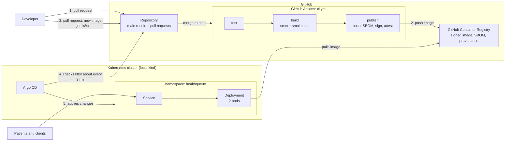

# HealthQueue Patient Scheduling API

The patient-facing appointment scheduling API for HealthQueue, a health-tech startup preparing to launch. It is a small Python service (standard library only), delivered through a pull-request-driven pipeline and deployed to Kubernetes with Argo CD (GitOps).

> **Status: pre-launch reference implementation.** Appointment data is held in memory, there is no authentication, and no real patient data should be used. See [Known limitations](#known-limitations).

## At a glance

| Area | What exists | Learn more |
|---|---|---|
| CI/CD and supply chain | Tests, vulnerability scan, SBOM, signed image, build provenance (SLSA Build Level 2) | [Supply chain summary](docs/supply-chain.md) |
| Infrastructure as code | OpenTofu on a LocalStack emulator, remote state, locking, plan comments, drift drill | [Infrastructure guide](infra/README.md) |
| Kubernetes and GitOps | Hardened Deployment and Service, deployed by Argo CD from Git | [Architecture](docs/architecture.md) |
| Observability | SLOs, error budget, alert rules, runbooks (designed, not deployed) | [SLOs](docs/slo.md), [plan](docs/observability.md) |
| Delivery metrics | DORA analysis on **synthetic** data | [DORA report](dora/output/report_SYNTHETIC.md) |
| Decisions | Eight architecture decision records and a leadership summary | [ADRs](docs/adr/README.md), [design decisions](docs/design-decisions.md) |

## Architecture



See [`docs/architecture.md`](docs/architecture.md) for the explanation, the infrastructure diagram, and what is real versus planned.

## API

| Method | Path | Description |
|---|---|---|
| GET | `/health` | Health check. Returns `{"status":"ok","version":"<app version>"}` |
| POST | `/appointments` | Book an appointment. Body: `patient_id`, `provider_id`, `slot` (ISO 8601 with timezone). Returns `201` with the appointment, `400` for invalid input, `409` if the provider is already booked at that slot |
| GET | `/appointments` | List appointments |
| GET | `/appointments/{id}` | Get one appointment, or `404` |

Any other path returns a 404 JSON error. Patients and providers are identified by opaque IDs only; the API stores no names or other personal details.

## Repository layout

```
.
├── app/                 API, Dockerfile, unit tests
├── k8s/                 Deployment and Service (what runs in the cluster)
├── argocd/              Argo CD Application (what Argo CD watches)
├── infra/               OpenTofu configuration and runbook
├── observability/       Alert rules (designed, not deployed)
├── dora/                Synthetic DORA script, tests, and output
├── docs/                Architecture, ADRs, SLOs, runbooks, supply chain, evidence
└── .github/             Workflows (ci, infra, infra-drift) and a shared action
```

## How a change reaches production

1. **Open a pull request.** CI runs `test` and `build`.
2. **Merge it.** `publish` pushes a signed image tagged `sha-<commit>` to GitHub Container Registry. Copy the tag from the job summary.
3. **Open a second pull request** that changes only the image tag in `k8s/deployment.yaml`, and merge it.
4. **Argo CD applies it** within about 3 minutes. No `kubectl apply`, no manual Sync.

Argo CD is configured with auto-sync, self-heal (manual changes are reverted), and prune (a deleted manifest deletes the live resource). The trade-offs are in [ADR 0001](docs/adr/0001-gitops-with-argo-cd.md).

## CI pipeline

`.github/workflows/ci.yml` runs on every pull request and on every merge to `main`.

| Job | Runs on | What it does |
|---|---|---|
| `test` | Pull requests and `main` | Runs the unit tests |
| `build` | Pull requests and `main` | Builds the image, scans it for vulnerabilities, and smoke-tests it. Never pushes. |
| `publish` | Merges to `main` only | Pushes the image, rescans the pushed digest, generates an SBOM, signs the image, and attests provenance and the SBOM |

### Why `test` and `build` are separate jobs

**Why:**

- **Observability.** Each job reports its own status on the pull request, so you can see at a glance whether the code or the container failed without opening a log. Each job also records its own duration, which shows where pipeline time goes and gives real timing data for lead-time analysis.
- **Independent required checks.** Branch rules can require `test` and `build` individually, and a failure names the stage that broke.
- **Different needs.** `test` needs only Python. `build` needs Docker.
- **Ordering is explicit.** `build` declares `needs: test`, so a failing test stops the build.

**Trade-offs we accepted:**

- Each job starts a fresh runner and checks out the code again, which adds a little time to every pull request. We judged that small compared with the clarity it buys. The per-job durations in the Actions tab show the actual cost.
- Jobs don't share files. `publish` rebuilds the image rather than reusing the one `build` scanned, so it rescans the exact digest it signs. The scan in `build` is early feedback; the scan in `publish` is the one that gates signing.

`publish` is separate for a different reason: it is the only job with write permissions (packages, signing, attestations) and it never runs on pull requests. See [ADR 0002](docs/adr/0002-separate-pipeline-jobs-and-least-privilege.md).

### Infrastructure pipeline

Changes under `infra/` have their own pipeline (`.github/workflows/infra.yml`): pull requests get a format check, validation, and a plan posted as a comment, and merges to `main` apply the saved plan against a fresh LocalStack. A manual "drift drill" workflow shows how drift is detected and reversed. See [`infra/README.md`](infra/README.md) for what this does and does not guarantee.

## Quick start: verify the deployment

You need Docker Desktop, `kubectl`, and a Kubernetes cluster with Argo CD installed. Once per cluster, tell Argo CD what to watch:

```
kubectl apply -f argocd/application.yaml
```

Then verify:

```
kubectl get application patient-scheduling-api -n argocd
kubectl get pods -n healthqueue
kubectl port-forward -n healthqueue svc/patient-scheduling-api 8080:80
curl.exe -i http://localhost:8080/health
```

In a second PowerShell window, book and list an appointment:

```
$body = @{ patient_id = "p-1001"; provider_id = "dr-42"; slot = "2026-11-02T15:00:00Z" } | ConvertTo-Json
Invoke-RestMethod -Method Post -Uri http://localhost:8080/appointments -ContentType "application/json" -Body $body
Invoke-RestMethod -Uri http://localhost:8080/appointments
```

Booking the same provider and slot again returns `409`. Because storage is per pod, a list request may not show the booking if it reaches the other replica (see [Known limitations](#known-limitations)).

## Change workflow (GitOps demo)

1. Edit `app/main.py` (for example, bump `VERSION`), open a pull request, and merge it. Wait for `publish` to finish and copy the `sha-<commit>` tag from its summary.
2. Create a branch, change only the image tag in `k8s/deployment.yaml`, open a pull request, and merge it.
3. Do not click Sync and do not run `kubectl apply`. Watch: `kubectl get pods -n healthqueue -w`
4. Prove it was automatic (Argo CD checks Git about every 3 minutes):

```
git pull
git log -1 --oneline
kubectl get application patient-scheduling-api -n argocd -o 'jsonpath={.status.sync.revision}'
kubectl get application patient-scheduling-api -n argocd -o 'jsonpath={.status.operationState.operation.initiatedBy}'
kubectl get deployment patient-scheduling-api -n healthqueue -o 'jsonpath={.spec.template.spec.containers[0].image}'
```

The revision should start with your merge commit ID, `initiatedBy` should show `{"automated":true}`, and the image should be the new tag.

### Optional self-heal demo

```
kubectl scale deployment patient-scheduling-api -n healthqueue --replicas=5
kubectl get pods -n healthqueue -w
```

Argo CD should return the Deployment to 2 replicas.

## Building an image by hand (fallback)

CI normally builds and publishes images. The first image, `v1.0.0`, was pushed manually before the pipeline existed, and this is how to do it if CI is unavailable. Manually pushed images are unsigned.

```
docker build -t ghcr.io/kayla-marcus/patient-scheduling-api:v1.0.0 app
docker login ghcr.io -u kayla-marcus      # paste your token at the prompt, in your own terminal only
docker push ghcr.io/kayla-marcus/patient-scheduling-api:v1.0.0
```

The package must be public (Packages > package settings > Change visibility) so the cluster can pull it.

## Known limitations

- **In-memory storage.** Appointments are lost when a pod restarts. The Deployment runs 2 replicas and each keeps its own copy, so a booking made through one pod may not appear when a request reaches the other. A shared database is required before launch ([ADR 0006](docs/adr/0006-in-memory-storage-is-a-prelaunch-limitation.md)).
- **No authentication, authorization, or TLS.**
- **Not for real patient data.** Use synthetic IDs only. Nothing in this repository claims compliance with any health data regulation.
- **Logging.** Each request writes one JSON line (method, path, status) to stderr. It deliberately omits client IPs and query strings.
- **Observability is a design.** The app exposes no metrics, and no monitoring stack is deployed.
- **Infrastructure runs on an emulator**, not a real cloud account ([ADR 0005](docs/adr/0005-localstack-for-infrastructure.md)).
- **DORA figures are synthetic.** They demonstrate a method and are not real performance.

## Documentation

| Document | What it covers |
|---|---|
| [`docs/architecture.md`](docs/architecture.md) | Diagrams, components, security boundaries, real versus planned |
| [`docs/design-decisions.md`](docs/design-decisions.md) | Decisions, trade-offs, and open questions for leadership |
| [`docs/adr/`](docs/adr/README.md) | Eight architecture decision records |
| [`docs/supply-chain.md`](docs/supply-chain.md) | Controls, SLSA Build Level 2 claim, known gaps |
| [`docs/slo.md`](docs/slo.md) | SLIs, SLOs, error budget, burn rates |
| [`docs/observability.md`](docs/observability.md) | Metrics, logs, and traces plan |
| [`docs/runbooks/`](docs/runbooks/high-error-rate.md) | High error rate, high latency, service down |
| [`infra/README.md`](infra/README.md) | OpenTofu runbook and the infrastructure pipeline |
| [`dora/output/report_SYNTHETIC.md`](dora/output/report_SYNTHETIC.md) | Synthetic DORA analysis |
| [`docs/evidence/`](docs/evidence/README.md) | Saved output and links that back the claims |
