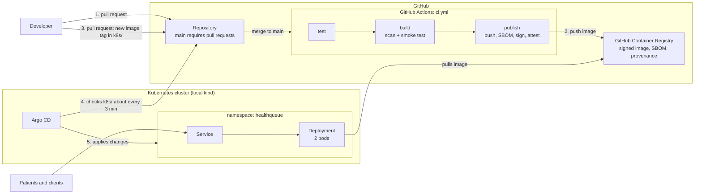
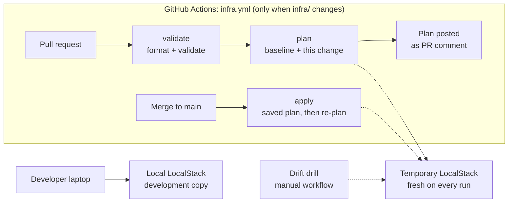

# Architecture

**Service:** HealthQueue patient scheduling API
**Last reviewed:** 2026-10-24

This page explains how a change travels from a developer's keyboard to running pods, what each part is responsible for, and which parts are real today versus planned. Diagrams are written in Mermaid, which GitHub renders automatically.

## Delivery overview

**Reading the diagram.** A developer opens a pull request (1). Merging it to `main` runs the pipeline, and `publish` pushes a signed image to the registry (2). Nothing runs in the cluster yet. A second pull request changes the image tag in `k8s/deployment.yaml` (3). Argo CD, which lives inside the cluster, notices the change in Git (4) and applies it (5). Git is the only way changes reach the cluster.

## Infrastructure overview

**Reading the diagram.** Infrastructure code in `infra/` is checked, planned, and applied by its own pipeline against a throwaway emulator. The laptop copy is separate and can drift, which is why the drift drill exists.

## Components

| Component | What it does | Where it is defined |
|---|---|---|
| API | Python standard-library HTTP service: `/health` and `/appointments` | `app/main.py` |
| Container image | Multi-stage build, non-root user, health check | `app/Dockerfile` |
| CI pipeline | Test, build, scan, then publish, SBOM, sign, attest | `.github/workflows/ci.yml` |
| Registry | Stores the image and its signature and attestations | GitHub Container Registry |
| Kubernetes workload | 2 replicas, probes, resource limits, hardened security context | `k8s/` |
| GitOps controller | Applies whatever `k8s/` says on `main`; reverts manual changes | `argocd/application.yaml` |
| Infrastructure as code | An S3 bucket and an SNS topic on an AWS emulator, with remote state | `infra/` |
| Infrastructure pipeline | Format, validate, plan comment, apply, drift drill | `.github/workflows/infra*.yml` |
| Reliability design | SLOs, error budget, alert rules, runbooks | `docs/slo.md`, `observability/`, `docs/runbooks/` |
| Delivery metrics | Synthetic 90-day DORA analysis | `dora/` |

## Security boundaries

- **Who can change what.** `main` is protected by a ruleset that requires pull requests. Only the `publish` job can write to the registry, and it runs only after a merge.
- **What CI can reach.** The cluster is never contacted by CI. There are no cluster credentials in GitHub. Argo CD pulls from a public repository, so the cluster holds no GitHub secret either.
- **What is signed.** The image digest is signed with cosign (keyless) and carries signed provenance and an SBOM. See `docs/supply-chain.md` for the claim (SLSA Build Level 2) and its limits.
- **What is not enforced.** Nothing in the cluster verifies signatures before running an image, and the deployment references a tag, not a digest. These are listed as known gaps.

## Real today versus planned

| Real and working | Planned or not yet true |
|---|---|
| CI with scan, SBOM, signing, provenance | Signature verification at deploy (admission policy) |
| Argo CD deployment from Git | A production cluster (today: local kind) |
| OpenTofu on an emulator with remote state and locking | Infrastructure on a real cloud account |
| SLOs, alert rules (syntax checked), runbooks | A deployed monitoring stack and `/metrics` in the app |
| Synthetic DORA analysis | Real delivery metrics from Git and GitHub events |
| Structured JSON request logs | Log collection, request IDs, tracing |
| In-memory bookings | A shared database (required before launch) |

## Why it is shaped this way

The decisions behind each box are recorded as short architecture decision records in [`docs/adr/`](adr/README.md). For the leadership summary and the open decisions, see [`docs/design-decisions.md`](design-decisions.md).
